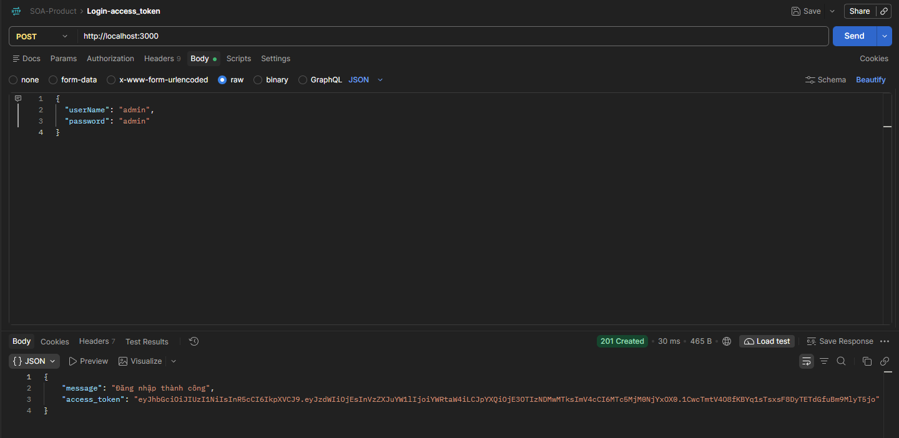
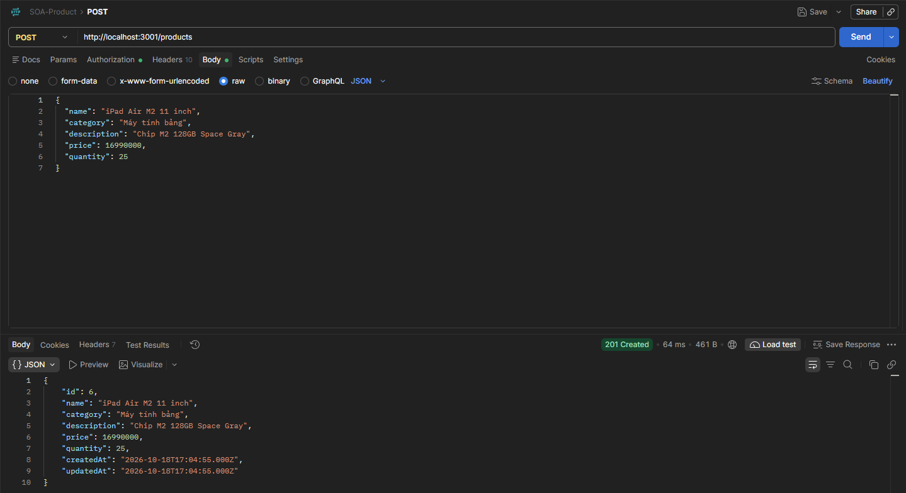
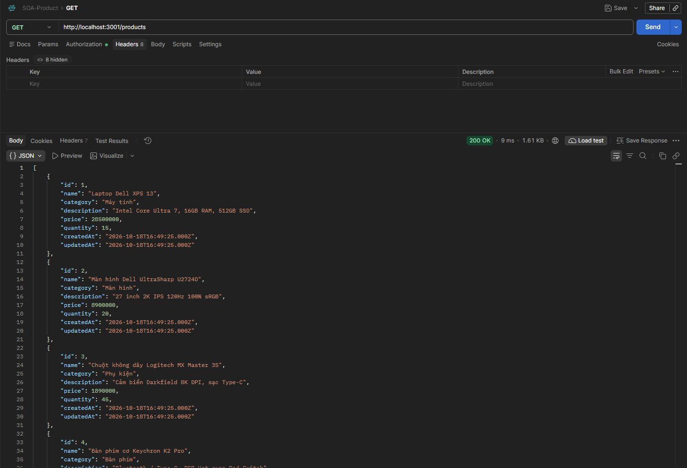
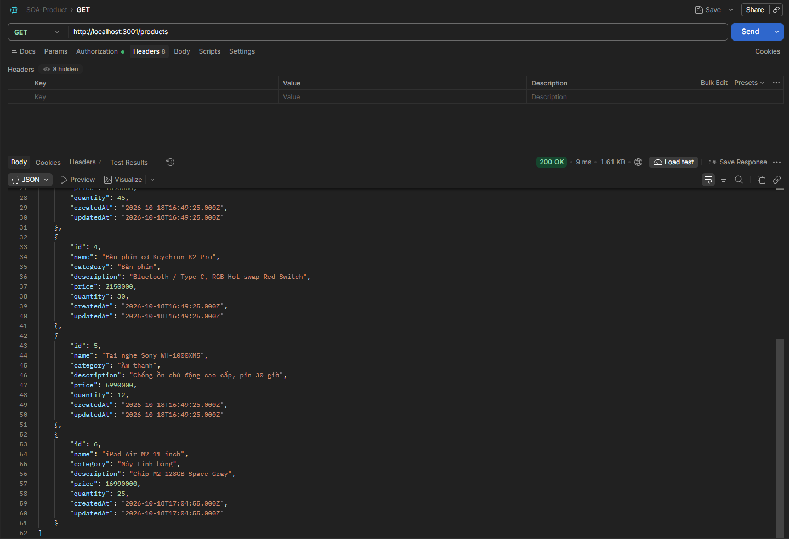
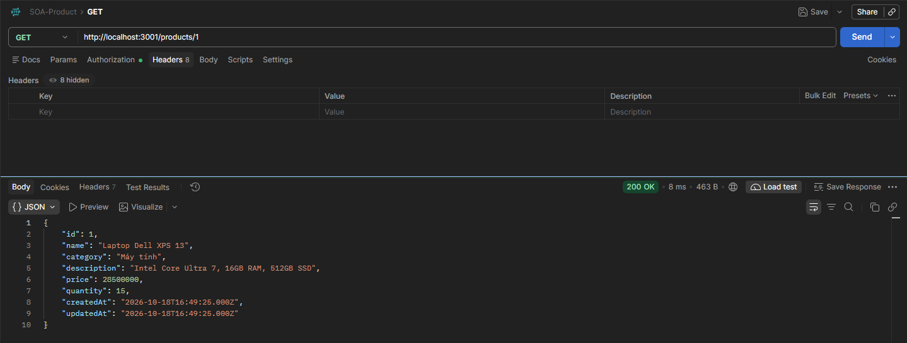
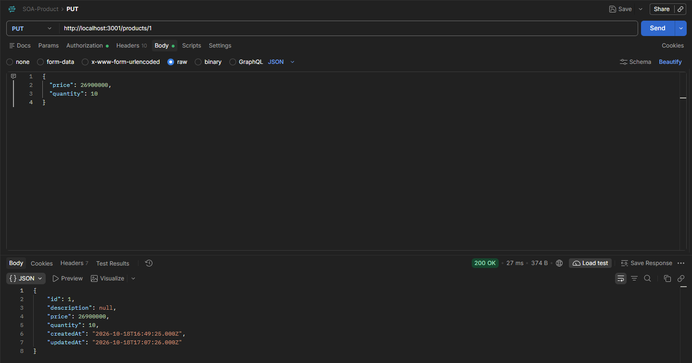
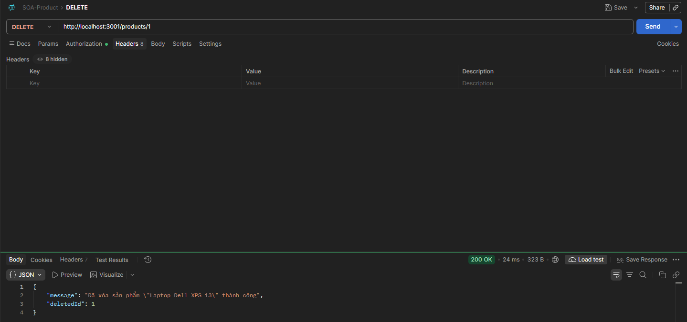
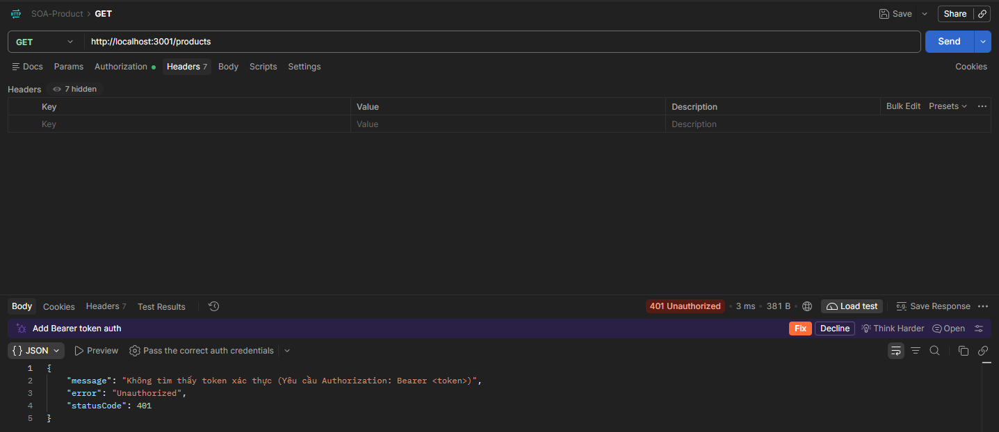

# BÀI THỰC HÀNH SỐ 3: DỊCH VỤ QUẢN LÝ SẢN PHẨM (SOA)

- **Sinh viên:** Huỳnh Ngọc Khang  
- **MSSV:** 4651050116  
- **Lớp:** K46D - Nhóm 5  

---

## 1. Tổng quan dịch vụ
- **Dịch vụ Sản phẩm:** Chạy trên cổng `3001`, cơ sở dữ liệu `product_db` (MySQL, bảng `products`).
- **Xác thực:** Sử dụng `AuthMiddleware` gọi HTTP sang Auth Service (`http://localhost:3000/auth`) để xác thực JWT token.

---

## 2. Danh sách API

Tất cả API đều yêu cầu header `Authorization: Bearer <token>`.

| Phương thức | Endpoint | Chức năng |
| :--- | :--- | :--- |
| `GET` | `/products` | Lấy danh sách sản phẩm (hỗ trợ `?search=` và `?category=`) |
| `GET` | `/products/:id` | Xem chi tiết sản phẩm theo ID |
| `POST` | `/products` | Thêm mới sản phẩm |
| `PUT` | `/products/:id` | Cập nhật thông tin sản phẩm |
| `DELETE` | `/products/:id` | Xóa sản phẩm |

---

## 3. Kết quả kiểm thử Postman

### 3.1. Đăng nhập lấy Token từ Auth Service (:3000)

### 3.2. Thêm mới sản phẩm (`POST /products`)

### 3.3. Lấy danh sách sản phẩm (`GET /products`)

### 3.4. Xem chi tiết sản phẩm (`GET /products/1`)

### 3.5. Cập nhật sản phẩm (`PUT /products/1`)

### 3.6. Xóa sản phẩm (`DELETE /products/1`)

### 3.7. Kiểm tra bảo mật khi không có Token (401 Unauthorized)

