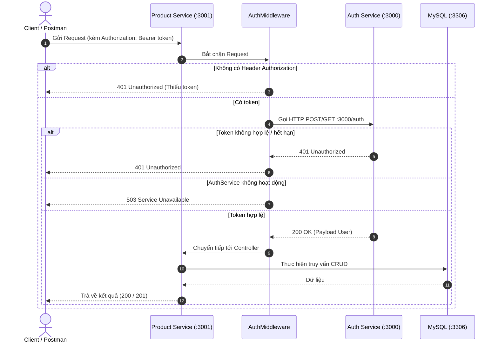

# BÁO CÁO BÀI THỰC HÀNH SỐ 3
## XÂY DỰNG DỊCH VỤ QUẢN LÝ SẢN PHẨM (PRODUCT SERVICE) TRONG HỆ THỐNG SOA

**Sinh viên thực hiện:** Huỳnh Ngọc Khang  
**MSSV:** 4651050116  
**Lớp:** K46D - Nhóm 5  
**Môn học:** Phát triển phần mềm hướng dịch vụ (SOA)  

---

## 1. Mục tiêu bài thực hành
- Thiết kế và xây dựng **Dịch vụ Quản lý Sản phẩm (Product Service)** độc lập theo nguyên lý kiến trúc hướng dịch vụ (Service-Oriented Architecture - SOA).
- Triển khai dịch vụ chạy trên cổng mạng và cơ sở dữ liệu hoàn toàn tách biệt với dịch vụ xác thực (Auth Service ở Bài thực hành số 2).
- Tích hợp bảo mật tập trung: Dịch vụ sản phẩm không lưu trữ khóa bí mật JWT hay tài khoản người dùng, mà ủy thác việc xác thực token bằng cách gọi HTTP API sang Dịch vụ xác thực.

---

## 2. Công nghệ sử dụng
- **Framework Backend:** NestJS (TypeScript)
- **Cơ sở dữ liệu:** MySQL (kết nối qua TypeORM)
- **Thư viện tích hợp:** `@nestjs/axios` (gọi HTTP liên dịch vụ), `class-validator`, `class-transformer`
- **Công cụ kiểm thử & tài liệu:** Postman

---

## 3. Kiến trúc và Tính độc lập của dịch vụ (SOA Principles)

Hệ thống được tổ chức thành 2 dịch vụ độc lập phân tán:

| Thuộc tính | Dịch vụ Xác thực (Bài thực hành 2) | Dịch vụ Sản phẩm (Bài thực hành 3) |
| :--- | :--- | :--- |
| **Cổng lắng nghe (Port)** | `3000` | `3001` (cấu hình qua `.env`) |
| **Cơ sở dữ liệu** | Database người dùng (`auth_db` / `user`) | `product_db` (bảng `products`) |
| **Nhiệm vụ chính** | Đăng nhập, mã hóa mật khẩu, sinh & xác thực JWT | CRUD quản lý sản phẩm, lọc & tìm kiếm |
| **Cơ chế giao tiếp** | Cung cấp API `GET /auth` hoặc `POST /auth` | Gọi HTTP Request sang cổng 3000 qua `AuthMiddleware` |

---

## 4. Thiết kế Cơ sở dữ liệu (`product_db`)

Cấu trúc bảng `products` (chi tiết tại [`database/product_db.sql`](database/product_db.sql)):

| Tên cột | Kiểu dữ liệu | Ràng buộc | Mô tả |
| :--- | :--- | :--- | :--- |
| `id` | `INT` | PRIMARY KEY, AUTO_INCREMENT | Mã định danh duy nhất của sản phẩm |
| `name` | `VARCHAR(255)` | NOT NULL | Tên sản phẩm |
| `category` | `VARCHAR(100)` | NOT NULL, DEFAULT 'Phụ kiện' | Phân loại danh mục sản phẩm |
| `description` | `TEXT` | NULL | Thông tin mô tả chi tiết sản phẩm |
| `price` | `DECIMAL(10, 2)` | NOT NULL | Giá bán sản phẩm |
| `quantity` | `INT` | NOT NULL, DEFAULT 0 | Số lượng tồn kho |
| `created_at` | `TIMESTAMP` | DEFAULT CURRENT_TIMESTAMP | Thời điểm tạo sản phẩm |
| `updated_at` | `TIMESTAMP` | ON UPDATE CURRENT_TIMESTAMP | Thời điểm cập nhật gần nhất |

---

## 5. Danh sách RESTful API

Tất cả các API dưới đây đều được bảo vệ bởi `AuthMiddleware` và yêu cầu header:  
`Authorization: Bearer <access_token>`

| STT | Phương thức | Đường dẫn API | Chức năng | Dữ liệu đầu vào / Query |
| :---: | :---: | :--- | :--- | :--- |
| 1 | `POST` | `/products` | Thêm mới sản phẩm | Body JSON (`name`, `category`, `price`, `quantity`,...) |
| 2 | `GET` | `/products` | Lấy danh sách sản phẩm | Hỗ trợ `?search=...` (tên) và `?category=...` |
| 3 | `GET` | `/products/:id` | Xem thông tin chi tiết | `id` (số nguyên) |
| 4 | `PUT` | `/products/:id` | Cập nhật thông tin | `id` và Body JSON các trường cần cập nhật |
| 5 | `DELETE` | `/products/:id` | Xóa sản phẩm khỏi hệ thống | `id` (số nguyên) |

---

## 6. Cơ chế Xác thực Phân tán (`AuthMiddleware`)

`AuthMiddleware` (`src/auth/auth.middleware.ts`) được gắn chặn trước tất cả các endpoint của `ProductController`:



---

## 7. Kết quả kiểm thử với Postman

| STT | Kịch bản kiểm thử | Dữ liệu kiểm thử | Kết quả kỳ vọng | Kết quả thực tế |
| :---: | :--- | :--- | :---: | :---: |
| 1 | `POST /products` hợp lệ | Có token, Body đúng format | `201 Created` | Đạt |
| 2 | `GET /products` lấy tất cả | Có token | `200 OK` | Đạt |
| 3 | `GET /products?search=Dell` | Tìm kiếm theo từ khóa | `200 OK` (Lọc đúng) | Đạt |
| 4 | `GET /products/:id` hợp lệ | `id = 1`, có token | `200 OK` | Đạt |
| 5 | `PUT /products/:id` | Cập nhật giá & số lượng | `200 OK` | Đạt |
| 6 | `DELETE /products/:id` | Xóa sản phẩm theo ID | `200 OK` | Đạt |
| 7 | Gọi API khi không có Token | Không gửi Header Authorization | `401 Unauthorized` | Đạt |
| 8 | Gọi API với Token không hợp lệ | Header: `Bearer token_sai` | `401 Unauthorized` | Đạt |
| 9 | `GET /products/9999` (ID không tồn tại) | ID không có trong cơ sở dữ liệu | `404 Not Found` | Đạt |
| 10 | `POST /products` với giá âm (`price: -10`) | Dữ liệu không thỏa ValidationPipe | `400 Bad Request` | Đạt |

### Ảnh chụp màn hình minh chứng:

#### 1. Đăng nhập lấy JWT Token từ Auth Service (`POST :3000`):


#### 2. Thêm mới sản phẩm (`POST /products`):


#### 3. Lấy danh sách sản phẩm (`GET /products`):


#### 4. Xem chi tiết sản phẩm (`GET /products/1`):


#### 5. Cập nhật sản phẩm (`PUT /products/1`):


#### 6. Xóa sản phẩm (`DELETE /products/1`):


#### 7. Chặn truy cập khi không có Token (`401 Unauthorized`):


---

## 8. Hướng dẫn cài đặt và khởi chạy

### Bước 1: Khởi tạo Cơ sở dữ liệu
Chạy script [`database/product.sql`](database/product.sql) trong MySQL (qua MySQL CLI, phpMyAdmin, hoặc DBeaver) để tạo database `product_db` và bảng `products`.

### Bước 2: Cài đặt thư viện
```bash
npm install
```

### Bước 3: Cấu hình biến môi trường
Tạo file `.env` từ file mẫu `.env.example`:
```env
PORT=3001
DB_HOST=localhost
DB_PORT=3306
DB_USER=root
DB_PASS=
DB_NAME=product_db
AUTH_URL=http://localhost:3000
```

### Bước 4: Khởi chạy dịch vụ
```bash
# Chế độ phát triển (auto-reload)
npm run start:dev

# Hoặc chế độ thường
npm start
```

---

## 9. Kết luận
Dịch vụ Quản lý Sản phẩm đã đáp ứng trọn vẹn các yêu cầu của Bài thực hành số 3:
1. Đảm bảo tính độc lập: chạy riêng trên cổng `3001` với cơ sở dữ liệu `product_db`.
2. Đầy đủ 5 thao tác CRUD chuẩn RESTful API có xác thực dữ liệu đầu vào.
3. Tích hợp xác thực phân tán mượt mà thông qua `AuthMiddleware` gọi dịch vụ xác thực ở Bài 2.
